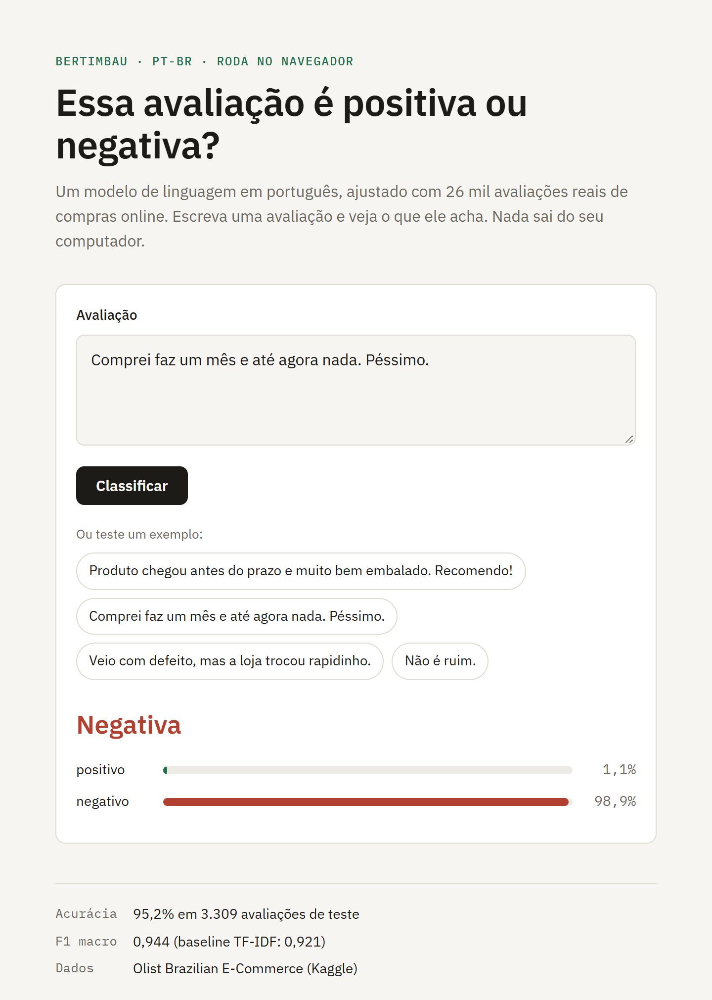
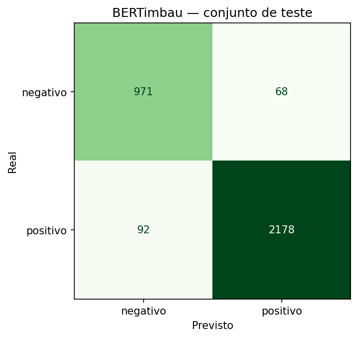

# Classificador de avaliações em português

Fine-tuning do **BERTimbau** (`neuralmind/bert-base-portuguese-cased`) para classificar avaliações de compras como **positivas** ou **negativas**, com dados reais do e-commerce brasileiro ([Olist, Kaggle](https://www.kaggle.com/datasets/olistbr/brazilian-ecommerce)). Tudo roda de graça no Google Colab, e o modelo final fica publicado no Hugging Face.

<a href="https://huggingface.co/spaces/Vwhtarj/classificador-avaliacoes"></a>

- **Teste no navegador:** [demo no Hugging Face Spaces](https://huggingface.co/spaces/Vwhtarj/classificador-avaliacoes). Roda no seu navegador com Transformers.js, sem servidor ([`demo/index.html`](demo/index.html)).
- **Modelo publicado:** [Vwhtarj/bertimbau-avaliacoes-olist](https://huggingface.co/Vwhtarj/bertimbau-avaliacoes-olist)
- **Notebook:** [`notebooks/treino_bertimbau_olist.ipynb`](notebooks/treino_bertimbau_olist.ipynb)

## Resultados (conjunto de teste)

3.309 avaliações nunca vistas no treino. Os dados somam 33.083 avaliações, das quais 68,6% são positivas.

| Modelo | Acurácia | F1 macro |
|---|---|---|
| TF-IDF + Regressão Logística (baseline) | 0,9293 | 0,9206 |
| **BERTimbau fine-tuned** | **0,9516** | **0,9442** |

Em relação ao baseline, o BERTimbau erra cerca de **30% menos**: a taxa de erro caiu de 7,1% para 4,8%. O treino levou 2 épocas numa GPU T4 gratuita do Colab.

## Análise de erros



O modelo errou 160 das 3.309 avaliações de teste. Li todas (a lista completa está em [`docs/erros.csv`](docs/erros.csv)), e a métrica sozinha esconde uma parte importante:

- **Muitos "erros" são do rótulo, não do modelo.** O rótulo vem da nota que o cliente deu, e muita gente dá 4–5 estrelas escrevendo uma reclamação. Nos 52 casos em que a nota era alta e o modelo disse "negativo" com mais de 90% de confiança, na minha leitura manual, 46 textos são reclamações claras ou não têm opinião nenhuma. Só 2 são erros reais do modelo.
- **No sentido oposto, os erros são mais interessantes.** Nos 40 casos com nota baixa que o modelo chamou de "positivo" com mais de 90%, 15 são textos elogiosos com nota 1–2 (rótulo errado de novo) e 11 são avaliações mistas. Os outros 12 são erros de verdade: o modelo se apega a expressões positivas, como *"antes do prazo"* e *"recomendo"*, e ignora a reclamação ao lado.

| Texto (resumido) | Nota | P(positivo) | Por que errou |
|---|---|---|---|
| "Não recebi o produto e já paguei a primeira parcela" | 5 | 0,01 | **Rótulo errado.** Reclamação com nota 5; o modelo acertou. |
| "Entrega super rápida... Produto com ótima qualidade... Super recomendo" | 1 | 1,00 | **Rótulo errado**, no sentido inverso. Provavelmente clicou na estrela errada. |
| "Tá mais fácil a criança nascer antes do que a mamadeira chegar" | 1 | 0,86 | **Ironia.** Não tem nenhuma palavra negativa. |
| "O que era para ser o presente de Natal, chegou depois de Reis" | 2 | 0,94 | **Conhecimento de mundo.** É preciso saber que o Dia de Reis vem depois do Natal. |
| "PRODUTO ENTREGUE VAZANDO DENTRO DA CAIXA... A ENTREGA FOI ANTES DO PRAZO" | 1 | 0,94 | **Atalho aprendido.** "Antes do prazo" é dos sinais mais fortes de elogio no dataset e venceu o "vazando". |
| "RECOMENDO. Somente 1 produto meu chegou, gostaria de saber do outro" | 1 | 0,99 | **Título contradiz a mensagem.** Título e mensagem são concatenados, e o "recomendo" do título dominou. |
| "Chegou apenas uma peça, mas na nota e na garantia constam as duas joias" | 1 | 0,58 | **Reclamação factual**, sem adjetivo. O modelo fica em dúvida, perto de 50%. |
| "ATRAZADA" | 1 | 0,77 | **Erro de grafia.** Com "atrasada" escrito certo, provavelmente acertaria. |
| "Excedeu as minhas expectativas!!!" | 5 | 0,03 | **Erro real.** Hipótese: no dataset, "excedeu" quase sempre vem em "excedeu o prazo". |
| "Baixíssima qualidade. Parece feito em casa. Nem forro tem. Vou devolver todos" | 1 | 1,00 | **Erro real, sem explicação óbvia.** É o caso mais intrigante da lista. |

**O que eu faria a seguir:**
1. **Limpar os rótulos** usando o próprio modelo: rever à mão os casos em que ele discorda da nota com mais de 90% de confiança e retreinar.
2. **Passar título e mensagem como par de frases** (`[SEP]`), em vez de concatenar, para o modelo saber de onde veio cada parte.
3. **Criar uma classe "mista"**, porque boa parte dos erros restantes são avaliações que elogiam uma coisa e reclamam de outra.

## Decisões

- **Rótulos:** nota 1–2 = negativo, 4–5 = positivo. A nota 3 fica de fora porque é ambígua.
- **Sem vazamento:** textos duplicados são removidos antes de dividir. O teste estratificado de 10% é usado uma única vez.
- **Baseline primeiro:** o TF-IDF + Regressão Logística mostra quanto o BERT realmente acrescenta.
- **Métrica:** como as classes são desbalanceadas, a principal é o F1 macro, não a acurácia.

## Como reproduzir

1. Crie as contas e os tokens:
   - no [Kaggle](https://www.kaggle.com/settings): *Create New Token* gera `KAGGLE_USERNAME` e `KAGGLE_KEY`;
   - no [Hugging Face](https://huggingface.co/settings/tokens): um token com permissão **Write** vira `HF_TOKEN`.
2. Abra o notebook no [Google Colab](https://colab.research.google.com/) (*Arquivo → Fazer upload de notebook*).
3. Escolha *Ambiente de execução → Alterar o tipo → GPU T4*.
4. Cadastre os três valores em **Secrets** (ícone de chave na barra lateral) e ligue o "Acesso ao notebook".
5. Rode *Ambiente de execução → Executar tudo*. O treino leva uns 15–25 minutos na T4.

No fim, o notebook publica o modelo e o model card em `seu-usuario/bertimbau-avaliacoes-olist` e grava `resultados.json` com as métricas.

## Uso do modelo publicado

```python
from transformers import pipeline

clf = pipeline("text-classification", model="Vwhtarj/bertimbau-avaliacoes-olist")
clf("Chegou rápido e funciona perfeitamente!")
```

## Limitações

O modelo foi treinado só com avaliações de e-commerce e é binário, sem classe neutra. Ironia continua difícil, e a nota dada pelo cliente é um rótulo ruidoso. Os detalhes estão no model card.
